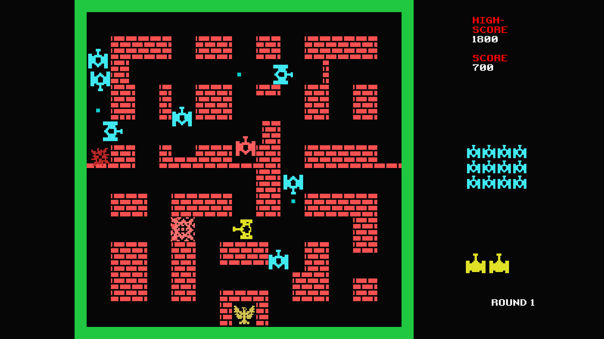
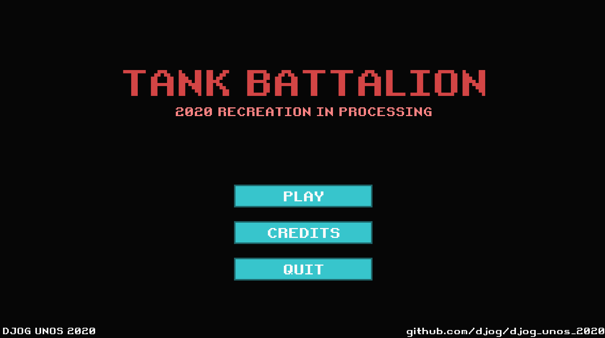
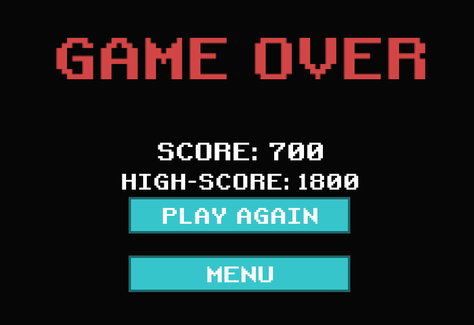

# Tank Battalion

Tank Battalion is one of [Richèl Bilderbeek's games](https://richelbilderbeek.github.io/games/).

A recreation of the arcade game Tank Battalion by the DJOG Uno's 2020 team in Processing.

## Download

- [Windows (64-bit)](https://dl.rijkvp.nl/Tank-Battalion_Windows64.zip)
- [Linux (64-bit)](https://dl.rijkvp.nl/Tank-Battalion_Linux64.tar)

Unzip the archive and run the executable to play! Make sure you have a JRE installed if you are using Linux. The Windows download comes bundled with a JRE.

## Screenshots

## Links

- [Source code](https://github.com/djog/tank_battalion)
